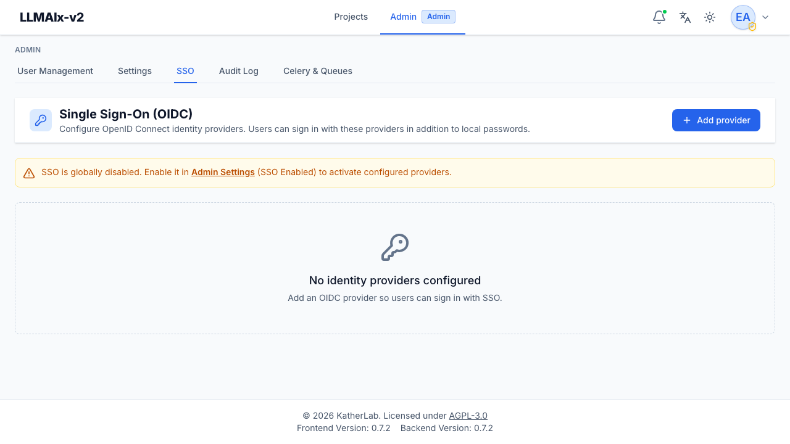

# Single sign-on (SSO)

**Single Sign-On (OIDC)** (`/admin/sso`) manages OpenID Connect identity
providers (Google, Keycloak, Azure AD, and any OIDC-compliant provider). The page
lists configured providers as cards and has an **Add provider** button in the
header.

<figure markdown>
  { width="820" }
  <figcaption>The SSO page: a warning that SSO is globally disabled until enabled in Settings, plus the empty "no identity providers configured" state.</figcaption>
</figure>

!!! note "Enable SSO globally first"
    SSO must be enabled in [system settings](settings.md) (**SSO Enabled**). When
    it's off, the page shows a warning banner with a link straight to the
    settings tab. You can still add and configure providers while SSO is
    globally off — they just won't appear on the login page until you flip the
    global switch.

## Adding a provider

**Add provider** opens a form:

- **Display name** — the label users see on the login page (e.g. "Google").
- **Issuer URL** — the provider's base URL; the app discovers its configuration
  from `{issuer}/.well-known/openid-configuration` (for example
  `https://accounts.google.com`).
- **Client ID** and **Client secret** — from the provider. The secret is stored
  **encrypted**. On **create**, the client secret is required. On **edit**, leave
  it blank to keep the current one — only enter a value to rotate it.
- **Scopes** — space-separated OIDC scopes; defaults to `openid email profile`.
- **Admin groups**, **User groups**, **Groups claim** — optional group mapping,
  see [below](#group-based-access-and-roles).
- **Enabled** — whether the provider is live and offered on the login page.

## Managing providers

Each provider row shows:

- its **display name** and an **Enabled** / **Disabled** status pill,
- a warning if **no client secret is set** yet,
- its **issuer URL**, **client ID**, and **scopes**, and
- **Edit** and **Delete** buttons.

Deleting a provider prompts for confirmation. It keeps linked users' accounts but
stops them signing in through that provider. To temporarily suspend a provider
without deleting it, edit it and clear the **Enabled** checkbox instead.

## Group-based access and roles

With at least one group list set, the identity provider decides who may sign in
and with which role. The role is re-evaluated on **every SSO login**:

| Groups claim contains | Result |
| --- | --- |
| an admin group | signs in as **admin** |
| a user group | signs in as **user** |
| neither, user groups configured | **refused**; no account is created |
| neither, user groups empty | signs in as **user** |

With both lists empty, anyone the provider authenticates may sign in, new accounts
get `SSO_JIT_DEFAULT_ROLE`, and roles are managed locally.

Good to know:

- A role changed under **User management** is overwritten at the user's next SSO
  login. Change the group membership instead.
- Names match exactly and case-sensitively. A leading slash is ignored, so `admins`
  matches both `admins` and `/admins`, but a subgroup needs its path:
  `org/admins`.
- **Removal from a group takes effect at the next SSO login**, which also ends
  that user's existing sessions. Until then an open session keeps working, and
  refresh tokens do not contact the provider. To cut someone off immediately,
  deactivate them under **User management** as well.
- Group checks only apply to SSO logins. An account with a local password can
  still use it, and users can set a password in their account settings. Set
  [`SSO_ONLY=true`](#sso-only-mode) to close that path.

## Configuring through `.env`

A provider can be declared through the environment instead of this page. The
backend writes it to the database on every start and shows it here with a
**Managed via .env** badge, read-only. Changes need a restart. If a provider with
the same name already exists, it is taken over and keeps its linked users. Removing
the variables disables the provider and makes it editable again.

If `SSO_OIDC_ISSUER_URL`, `SSO_OIDC_CLIENT_ID` and `SSO_OIDC_CLIENT_SECRET` are only
partly set, the backend refuses to start.

### No local admin needed

While an enabled provider maps an admin group (and `SSO_ENABLED` is on), the
first-admin setup page stays closed. The login page offers SSO straight away and the
first member of the admin group to sign in becomes admin.

### SSO-only mode

`SSO_ONLY=true` makes the identity provider the only way in. The backend refuses
password sign-in, registration, first-admin setup, password changes and resets, and
new invitations, and the matching pages and buttons disappear.

- **Startup:** the backend refuses to start without `SSO_ENABLED=true` and an enabled
  provider. While it runs, SSO can't be switched off and the last enabled provider
  can't be disabled or deleted. An unreachable provider does not stop the backend,
  but nobody can sign in until it is back.
- **Existing accounts:** a local account gets its SSO link on the first login with
  the same verified email. Accounts without a link can no longer renew their session
  and are signed out when their access token expires (`ACCESS_TOKEN_EXPIRE_MINUTES`).
- **Existing sessions of SSO users** are unaffected and follow the
  [group rules above](#group-based-access-and-roles).

!!! warning "There is no emergency login"
    If the provider is gone for good, remove `SSO_ONLY` and restart the backend.
    Accounts with a password then work again. Accounts created through SSO have none
    and need **Forgot password**, which requires working email (SMTP). Without SMTP
    and without an admin who has a password, recovery means changing the database
    directly, so configure SMTP or keep one admin account with a password.

### Keycloak example

**1. Create the client** in your realm (*Clients → Create client*):

- Client type **OpenID Connect**, client ID `llmaixweb`
- **Client authentication** on, **Standard flow** on
- Valid redirect URI: `https://<your-app>/api/v1/auth/sso/keycloak/callback`.
  `keycloak` is derived from `SSO_OIDC_NAME`, the origin from `APP_URL`.
- Copy the secret from the **Credentials** tab.

**2. Add the groups mapper** (*Clients → llmaixweb → Client scopes →
llmaixweb-dedicated → Add mapper → By configuration → Group Membership*):

- Name and **Token Claim Name**: `groups`
- **Add to ID token** on (or **Add to userinfo**)

Without this mapper the claim is missing and everyone is treated as being in no
group. The backend logs a warning naming the missing claim.

**3. Create the groups** (e.g. `llmaix-users`, `llmaix-admins`) and assign users.
Admins only need the admin group.

**4. Configure the app:**

```bash
APP_URL=https://<your-app>
SSO_ENABLED=true
SSO_OIDC_NAME=Keycloak
SSO_OIDC_ISSUER_URL=https://keycloak.example.org/realms/my-realm
SSO_OIDC_CLIENT_ID=llmaixweb
SSO_OIDC_CLIENT_SECRET=<secret>
SSO_OIDC_USER_GROUPS=llmaix-users
SSO_OIDC_ADMIN_GROUPS=llmaix-admins
```

!!! warning "Common Keycloak pitfalls"
    - **Email not verified:** by default, users without **Email verified** in
      Keycloak are rejected on first login. Mark them verified, or set
      `SSO_REQUIRE_VERIFIED_EMAIL=false` if only the IdP can set emails in your realm.
    - **Issuer URL:** the backend and the browser must both reach Keycloak under the
      same URL, because the issuer in the token must match it. An internal Docker
      hostname does not work unless browsers can resolve it too.

## How sign-in works

The login flow uses **PKCE** and a short-lived **signed state**, with the
redirect URI derived from the app's configured URL. On first sign-in, users are
**provisioned just-in-time**: linked to an existing identity, matched to an
existing account by email, or created new — governed by settings such as whether
a verified email is required, whether an invitation is required, and the default
role for new SSO users.

SSO-only users have no password until they set one on the
[account settings](../user-guide/account.md) page. Users can see and disconnect
their linked providers there too (subject to always keeping one sign-in method).

!!! warning "Redirect URI and issuer must match the provider config"
    Register the app's SSO callback URL (derived from your configured base URL)
    as an allowed redirect URI at the provider, and make sure the **Issuer URL**
    exactly matches the provider's issuer. Mismatches are the most common cause
    of failed SSO logins.

SSO provider changes (create/update/delete) and SSO logins are recorded in the
[audit log](../AUDIT_LOGGING.md).
